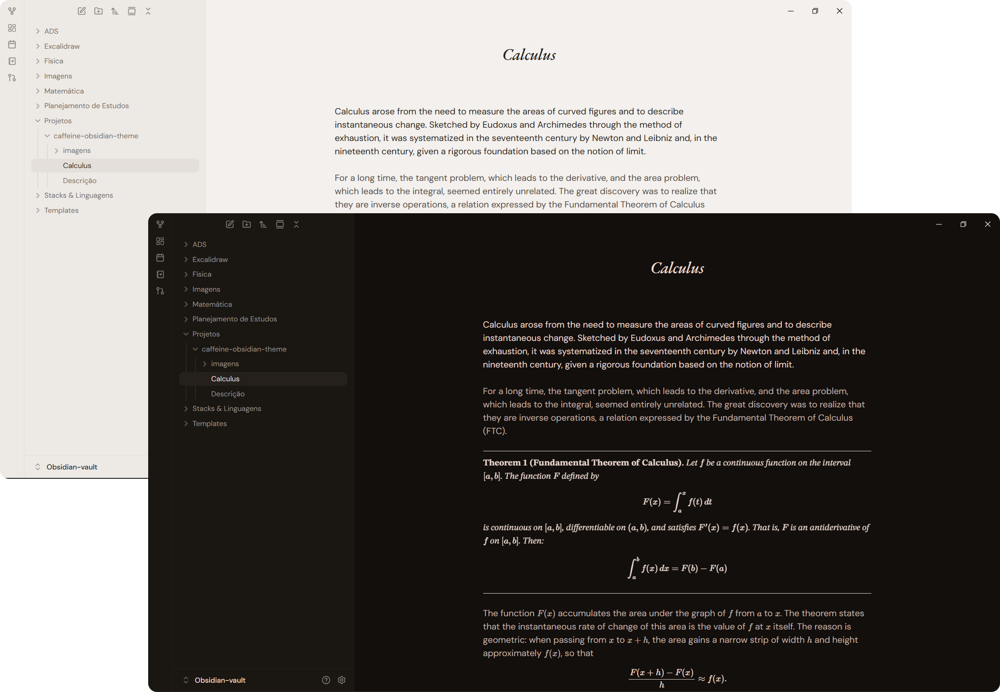
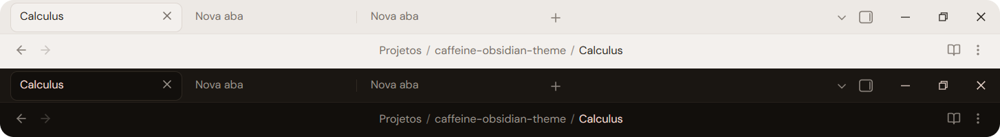
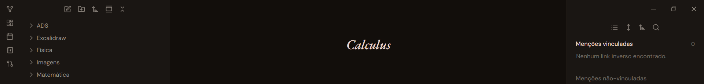
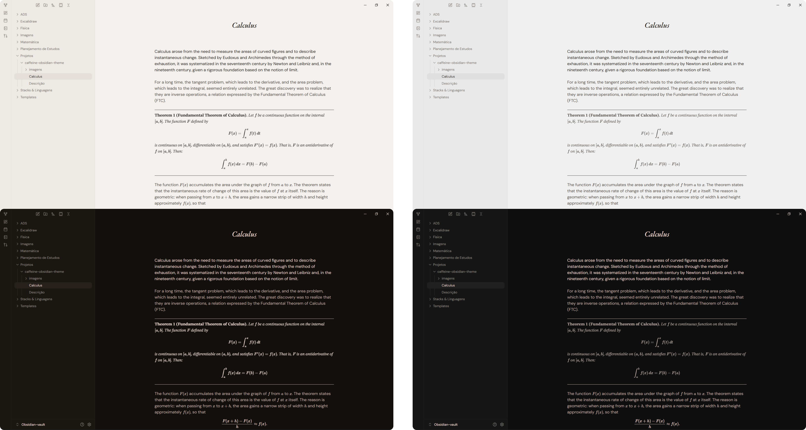
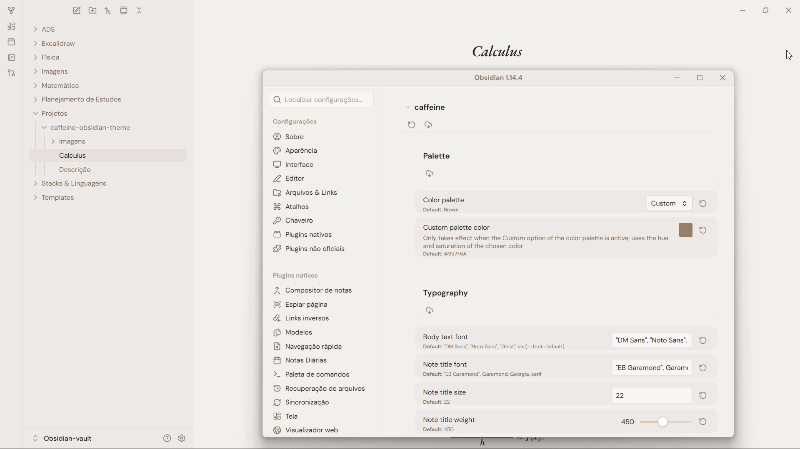
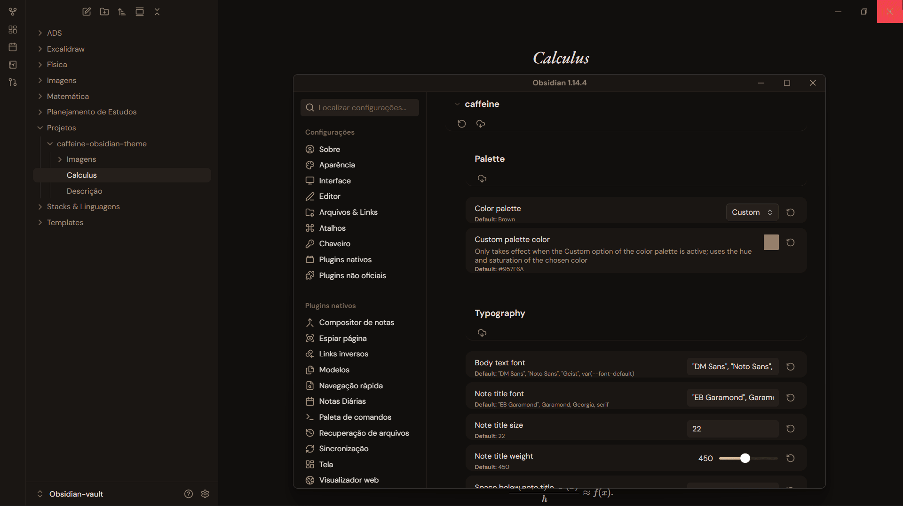
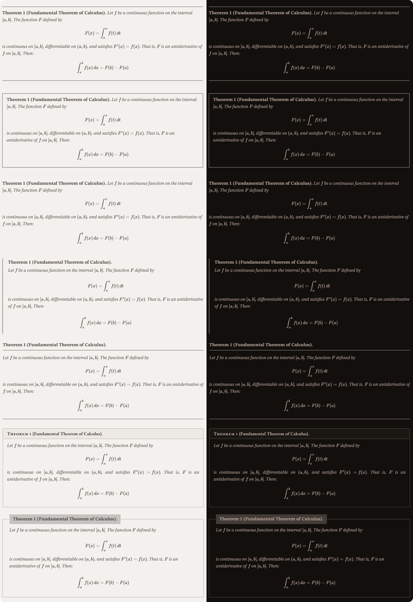
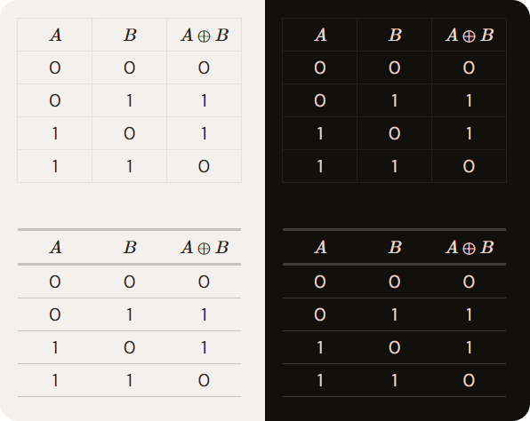

<h1 style="text-align: center; font-family: 'EB Garamond', Georgia, serif; font-style: italic; font-weight: bold;">caffeine</h1>

A warm and comfortable theme for Obsidian, designed to make your notes easier on the eyes without sacrificing flexibility. Built around a carefully crafted brown palette, <strong><em>caffeine</em></strong> also offers a neutral gray palette and a fully customizable option. With the latter, you choose a single color, and the theme automatically generates a cohesive palette based on its hue and saturation, adapting it to both light and dark modes.

Through the **Style Settings** plugin, you can customize the color palette, typography, table styles, and more. <strong><em>caffeine</em></strong> is also compatible with the **LaTeX-like Theorem & Equation Referencer** plugin, offering seven theorem layouts and additional options for customizing theorem text and titles.

The [**Style Settings**](https://community.obsidian.md/plugins/obsidian-style-settings) plugin is required for the theme to work correctly. Download it from the Obsidian community plugins page.

# Bars

The tab bar has been redesigned to accommodate floating tabs, along with a centered file breadcrumb.

Through **Style Settings**, you can restore the default Obsidian design for the tab bar.

In addition, the tab bar now has a dynamic behavior: by default, it stays hidden and appears when you hover over the top of the screen.

The status bar works the same way: hidden by default, it appears when you hover over it.

The dynamic behavior of the top bars and the status bar can be turned off in the **Style Settings** options.

# Palettes

The Brown Palette is the default, built around warm, earthy tones for a calm reading experience. Gray provides a more neutral alternative, preserving the same visual language with a balanced grayscale.

The **Custom Palette** lets you create a color scheme based on any color of your choice. Simply select a color through Style Settings, and the theme generates the rest of the palette from its hue and saturation. The resulting colors are adjusted for the selected mode, creating a cohesive appearance in both light and dark modes while maintaining the theme's visual balance.

# Theorem Styles

The theme is compatible with the LaTeX-like Theorem & Equation Referencer plugin and offers seven distinct theorem styles: **Rules**, **Frame**, **Classic**, **Side Bar**, **Ruled Header**, **Header band** and **Tabbed Frame**. Through **Style Settings**, you can also customize theorem text, choosing between italic and upright styles, as well as the weight of theorem types and titles, with bold and normal options.

To enable these custom styles, open the plugin settings and go to Global → Theorem callouts - general. Change the Style option to Custom. Then, simply choose your preferred theorem style from the <strong><em>caffeine</em></strong> theme options in Style Settings.

# Tables

Two table styles are available through Style Settings: **Horizontal lines** and **Obsidian default**. The Horizontal lines style removes vertical column borders and emphasizes the table header with stronger horizontal rules for a cleaner, more structured appearance, while Obsidian default preserves the standard Obsidian table style.

# Fonts

The theme applies fonts in the order listed below, which is also their order of priority: it uses the first font of each category that is installed on your system and falls back to the next one otherwise. For the theme to work as intended, download and install the fonts through Google Fonts, preferably starting with the first of each category.

- For note titles:
	1. [EB Garamond](https://fonts.google.com/specimen/EB+Garamond)
	2. Garamond (system font)
	3. Georgia (system font)
- For text and interface:
	1. [DM Sans](https://fonts.google.com/specimen/DM+Sans)
	2. [Noto Sans](https://fonts.google.com/specimen/Noto+Sans)
	3. [Geist](https://fonts.google.com/specimen/Geist)
	4. Obsidian default
- For monospace:
	1. [Fira Code](https://fonts.google.com/specimen/Fira+Code)
	2. [JetBrains Mono](https://fonts.google.com/specimen/JetBrains+Mono)
	3. [Noto Sans Mono](https://fonts.google.com/specimen/Noto+Sans+Mono)
	4. Obsidian default